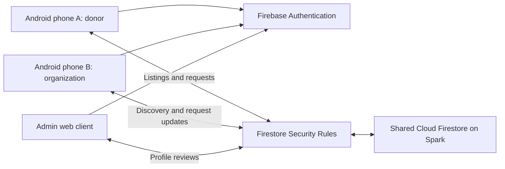

# 04 — System Architecture

The Android app serves two roles with distinct accounts. The separate web client handles verification. Each client connects to the same project and only reads data authorized for its identity. The donor app computes smart matching locally.

The donor saves a draft and optionally attaches a compressed JPEG in a separate document. The organization listens for open listings and writes a request under the listing. The donor listens for requests and approves one using a Firestore transaction. At pickup the recipient writes its confirmation, then the donor atomically completes the listing and request. Rules link those writes and reject competing approvals or repeated pickup.

[Schema](05_DATABASE_SCHEMA.md) · [Security](09_SECURITY_AND_PERMISSIONS.md) · [Integrations](10_API_AND_INTEGRATIONS.md)
